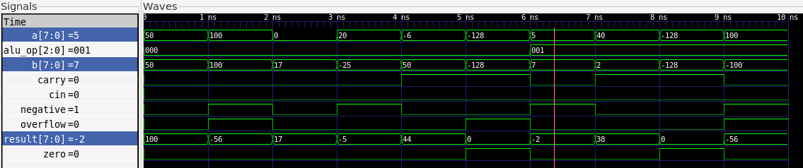

# 8-bit CPU
This will be an 8-bit, Harvard-architecture CPU with a custom instruction set designed from scratch and implemented in Verilog.
## Architecture
- Four registers (R0, R1, R2, R3)
- Harvard-architecture: 256 x 16 instruction ROM, 256 x 8 data RAM
- 8-bit program counter
- Negative, Zero, Carry, and oVerflow flags
## Instruction Format
```
        15    12 11  10 9   8 7   6 5    3 2   1   0
       ┌────────┬──────┬─────┬─────┬──────┬───┬─────┐
R-type │ opcode │  RD  │ RS1 │ RS2 │funct.│ w │ --- │
       ├────────┼──────┼─────┼─────┴──────┴───┴─────┤
I-type │ opcode │  RD  │ --- │    immediate[7:0]    │
       ├────────┼──────┴─────┼──────────────────────┤
J-type │ opcode │ condition  │     address[7:0]     │
       └────────┴────────────┴──────────────────────┘
```
### Register-Type
RD: Destination register

RS1: First operand

RS2: Second operand

Function: Type of operation to perform

W: If W == 1, write to RD, else only update flags (CMP)

---: Reserved bits
### Immediate-Type
RD: Destination register

---: Reserved bits

Immediate: 8-bit value for direct register assignment; 8-bit RAM address for loading and storing to and from RD
### Jump-Type
Condition: 4-bit code for jump conditions

Address: 8-bit address to jump to in ROM
## Instruction Set

| Opcode | Function | Condition | W   | Mnemonic | Operation                | Flags Set | Flags Tested      |
| ------ | -------- | --------- | --- | -------- | ------------------------ | --------- | ----------------- |
| 0000   | -        | -         | -   | STOP     | Stop the program counter | no        | -                 |
| 0001   | 000      | -         | 1   | ADD      | RD = RS1 + RS2           | yes       | -                 |
| 0001   | 001      | -         | 1   | SUB      | RD = RS1 - RS2           | yes       | -                 |
| 0001   | 001      | -         | 0   | CMP      | RS1 - RS2                | yes       | -                 |
| 0001   | 010      | -         | 1   | AND      | RD = RS1 & RS2           | yes       | -                 |
| 0001   | 011      | -         | 1   | OR       | RD = RS1 \| RS2          | yes       | -                 |
| 0001   | 100      | -         | 1   | ADC      | RD = RS1 + RS2 + C       | yes       | C                 |
| 0010   | -        | -         | -   | SET      | RD = immediate           | no        | -                 |
| 0011   | -        | -         | -   | LD       | RD = RAM[immediate]      | no        | -                 |
| 0100   | -        | -         | -   | ST       | RAM[immediate] = RD      | no        | -                 |
| 1111   | -        | 1111      | -   | JMP      | Jump unconditionally     | no        | -                 |
| 1111   | -        | 0000      | -   | JEQ      | Jump if equal            | no        | Z == 1            |
| 1111   | -        | 0001      | -   | JNE      | Jump if not equal        | no        | Z == 0            |
| 1111   | -        | 0010      | -   | JGT      | Jump if greater (signed) | no        | Z == 0 and N == V |
| 1111   | -        | 0011      | -   | JLT      | Jump if less (signed)    | no        | N != V            |

- Any ALU instruction can set W = 0 to only affect flags.
- After SUB/CMP, C == 1 means no borrow (RS1 >= RS2, unsigned)
## Progress
- [x] ISA specification
- [ ] ALU
- [ ] Register file
- [ ] ROM
- [ ] RAM
- [ ] Control unit
- [ ] Python assembler
- [ ] Example programs
- [ ] C++ emulator
## Showcase
### GTKWave showing ALU addition and subtraction operations:


Each 1 ns segment is a different check performed by the ALU testbench.
- The 5-6 ns range shows ALU operation 000, addition, on -128 and -128, resulting in 0 and the zero, carry, and overflow flags being raised. The zero flag is raised because the result wraps around to 0. The carry flag is raised because the unsigned result is 256, or 9'b100000000. The overflow flag is raised because the signed range -128 to 127 was exceeded.
- The 6-7 ns range shows ALU operation 001, subtraction, on 5 and 7, resulting in -2 and the negative flag being raised.